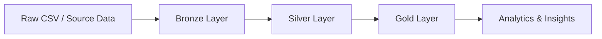

# DataBricks IAP Assessment

> TPC-H Sales & Supply Chain Lakehouse Data Engineering + Data Analytics

<p align="center">
  
  
  
  
</p>

<svg width="100%" height="170" viewBox="0 0 760 170" xmlns="http://www.w3.org/2000/svg" role="img" aria-label="Animated data pipeline banner">
  <defs>
    <linearGradient id="sky" x1="0" x2="1">
      <stop offset="0%" stop-color="#e0f2fe"/>
      <stop offset="100%" stop-color="#f8fafc"/>
    </linearGradient>
  </defs>
  <rect width="760" height="170" rx="18" fill="url(#sky)"/>
  <g fill="#94a3b8" opacity="0.9">
    <text x="60" y="42" font-size="22">☁️</text>
    <text x="500" y="55" font-size="20">☁️</text>
    <text x="610" y="38" font-size="24">☁️</text>
  </g>
  <g>
    <text x="0" y="95" font-size="38">✈️</text>
    <animateTransform attributeName="transform" type="translate" values="0 0; 620 0; 0 0" dur="8s" repeatCount="indefinite"/>
  </g>
  <g fill="#0f172a" font-family="Segoe UI, Arial, sans-serif" font-size="14">
    <text x="18" y="135">Bronze</text>
    <text x="270" y="135">Silver</text>
    <text x="520" y="135">Gold</text>
  </g>
</svg>

## Overview
This project is a Databricks-based IAP assessment designed around the TPC-H benchmark to model a modern sales and supply-chain lakehouse. The goal is to transform raw data into trusted, analytics-ready datasets for business reporting and decision-making.

## Business Scenario
You are working as a Data Engineer and Data Analyst for a global wholesale distribution business operating across multiple countries and regions. The business sells products to customers while managing supplier and order data across the full supply chain.

The project focuses on understanding:
- Net sales revenue generated
- Customer, product, country, and region contribution to revenue
- Sales and order trends over time
- Operational insights for supply-chain and commercial performance

## What this project does
- Ingests raw transactional data into a Bronze layer
- Cleanses, validates, and standardizes records in Silver
- Builds governed, curated datasets in Gold for analysis
- Applies business rules and data quality checks
- Enables KPI and trend analysis using SQL / PySpark on Databricks

## Tech Stack
- Databricks
- Delta Lake
- Unity Catalog
- Apache Spark / PySpark
- SQL
- Medallion Architecture

## Architecture



## Business Questions Answered
- How much net sales revenue is generated?
- Which customers, products, countries, and regions contribute the most?
- How are orders and sales changing over time?
- Which suppliers and products need deeper review?
- What insights can be derived from the curated lakehouse datasets?

## Data Model Highlights
- Customer master data
- Product catalog
- Order and sales facts
- Supplier and regional dimension data
- Time-based aggregates and product performance views

## Quality & Governance
- Primary key validation
- Numeric and date checks
- Referential integrity validation
- Quarantine handling for invalid records
- Bronze-to-Silver reconciliation and controlled transformations

## Project Status
This project is structured as a clean, end-to-end Databricks lakehouse workflow for learning and assessment purposes.

## Example Pipeline Concept

```text
Raw source data
    ↓
Bronze tables
    ↓
Silver validation + cleansing
    ↓
Gold analytical datasets
    ↓
Business insights / dashboards / reporting
```

## Notes
This project uses the TPC-H synthetic benchmark dataset as a realistic exercise for data engineering and analytics, not as a live company dataset.

---

<p align="center">
  <b>Built with ❤️ for data engineering, analytics, and the Databricks Lakehouse approach.</b>
</p>
